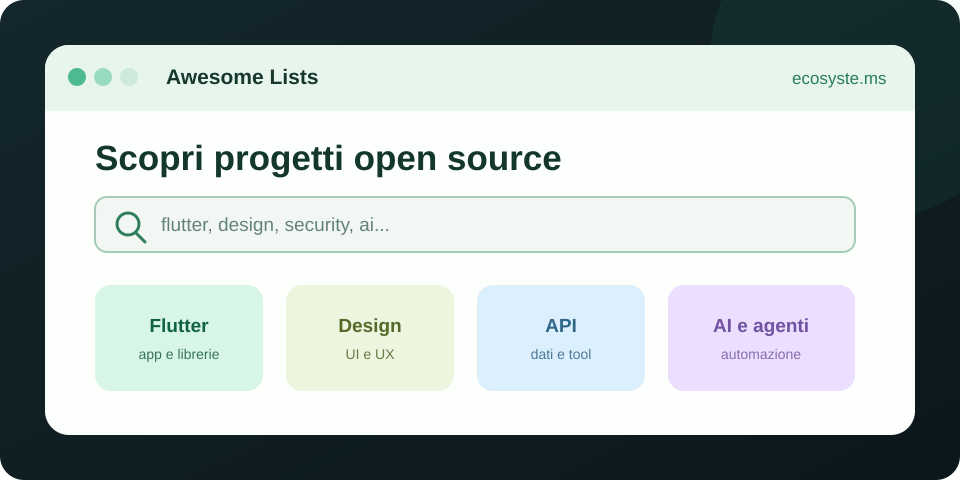
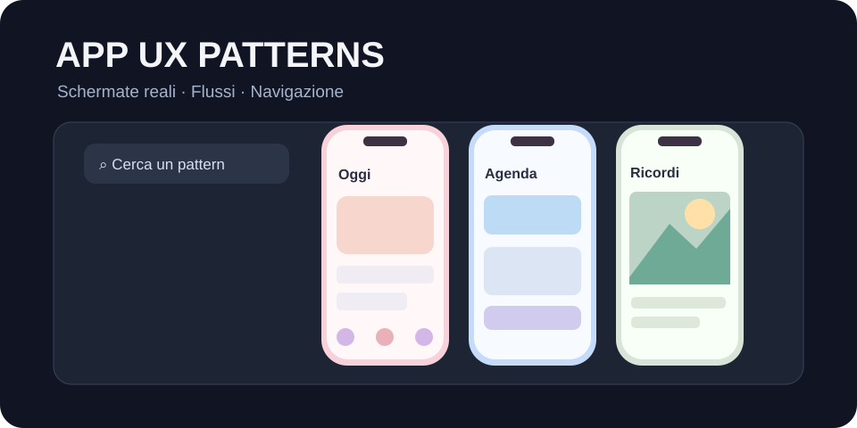
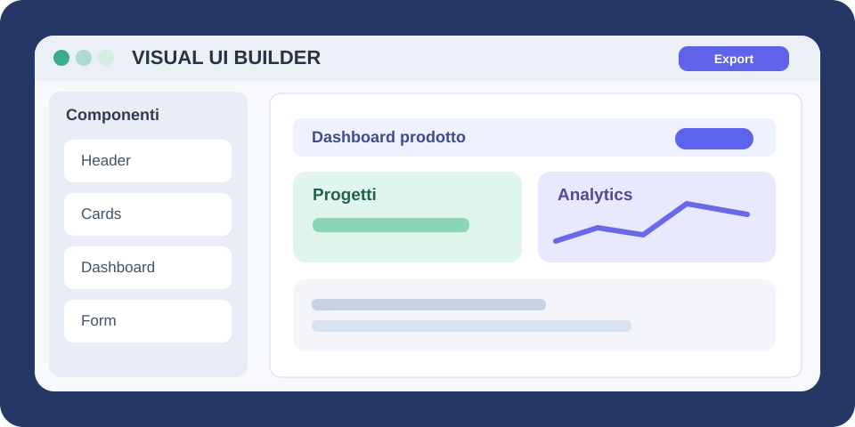
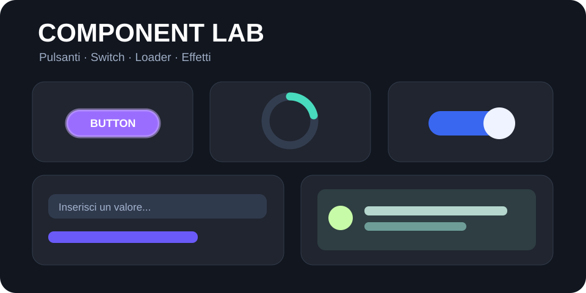
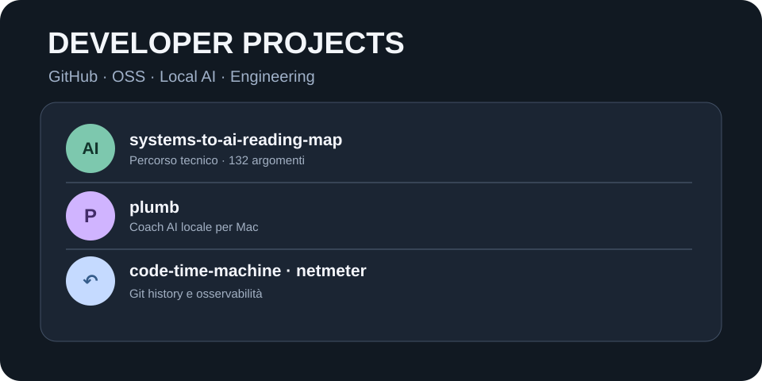

# Siti belli e interessanti per idee

Archivio **curato dall'utente** di siti Web che meritano di essere ritrovati: design, UX, animazioni, software libero, strumenti, idee di prodotto, AI e risorse per la **App Factory**.

> Questo repository è una raccolta di **riferimenti e opportunità**, non una libreria di codice già approvato. Il salvataggio di un sito non autorizza automaticamente a copiarne grafica, immagini, testi o codice.

## Esplora i siti

| Anteprima illustrativa | Sito | Categoria | Perché è interessante | Scheda |
|---|---|---|---|---|
|  | **[Awesome Lists · ecosyste.ms](https://awesome.ecosyste.ms/)** | Open source · Ricerca e strumenti | Trova liste curate di librerie, tool e progetti OSS; possibili donor per App Factory | [SITE-001](schede/SITE-001-awesome-ecosystems.md) |
|  | **[HUMAN.md](https://www.human-md.ai/)** | Design · Storytelling · AI e creatività | Manifesto sul ruolo creativo umano nell'era AI, presentato con un'esperienza visiva immersiva | [SITE-002](schede/SITE-002-human-md.md) |

|  | **[Mobbin · iOS Popular](https://mobbin.com/discover/apps/ios/popular)** | Design mobile · UX research | Esplora schermate e flussi di app reali per confrontare navigazione, onboarding e pattern UI | [SITE-003](schede/SITE-003-mobbin.md) |
|  | **[Shuffle](https://shuffle.dev/)** | Editor visivo · UI web | Componi layout responsive e blocchi per landing, dashboard e Web Utility | [SITE-004](schede/SITE-004-shuffle.md) |
|  | **[Uiverse](https://uiverse.io/)** | Componenti · Micro-interazioni | Catalogo di elementi UI community-made per pulsanti, input, card, loader e motion | [SITE-005](schede/SITE-005-uiverse.md) |
|  | **[nagavineerpasam · GitHub](https://github.com/nagavineerpasam?tab=repositories)** | Profili GitHub · Progetti OSS | Progetti e riferimenti per AI locale, strumenti sviluppo e formazione tecnica | [SITE-006](schede/SITE-006-nagavineerpasam.md) |

**Nota sulle immagini:** le copertine SVG sono **illustrazioni originali create per l'indice**, non screenshot fedeli né asset prelevati dai siti. Le pagine originali sono raggiungibili cliccando sull'anteprima. In futuro si potranno aggiungere screenshot con fonte e diritti verificati.

## Come usare l'archivio

- **Per cercare idee:** aprire una scheda e leggere il possibile impiego nelle app.
- **Per il design:** i siti grafici possono suggerire candidati da analizzare in [Design-App](https://github.com/riccardopinato/Design-App). Le reference che l'utente ha selezionato e approvato in Design-App hanno priorità nelle proposte estetiche, secondo il Master corrente.
- **Per codice e librerie:** studiare prima i singoli repository, le licenze, lo stato di manutenzione e i test. Non confondere un elenco di progetti con un donor verificato.
- **Per creare nuove app o capability:** valutare fattibilità e riuso; passare al repository idee/capability soltanto quando esiste una proposta specifica, senza duplicare automaticamente schede.

## Archivio strutturato

- [Catalogo machine-readable](catalogo/siti.json): ID, URL canonico, categorie, tag, utilità potenziale, provenienza e stato di esame.
- [Categorie e regole di archiviazione](CATEGORIE.md): come classificare i prossimi link ed evitare duplicati.
- [Schede dettagliate](schede/): note sintetiche e possibili applicazioni all'ecosistema.

**Catalogo aggiornato:** 6 riferimenti archiviati al **18 novembre 2026** (2 iniziali + 4 nuovi). L'inclusione nell'archivio indica interesse espresso dall'utente, non implementazione, certificazione o approvazione di un asset esterno.

## Collegamento con gli altri repository

| Repository | Ruolo |
|---|---|
| [Siti-belli-e-interessanti-per-idee](https://github.com/riccardopinato/Siti-belli-e-interessanti-per-idee) | Raccolta originale di link, schede, fonti e spunti |
| [Design-App](https://github.com/riccardopinato/Design-App) | Reference visive selezionate, stili, componenti e design utilizzabile |
| [Idee-app-Archivi-riferimenti](https://github.com/riccardopinato/Idee-app-Archivi-riferimenti) | Idee di prodotto, capability e valutazioni implementative |
| [App-Factory-Core](https://github.com/riccardopinato/App-Factory-Core) | Master Prompt e regole tecniche autorevoli |

L'archivio **non modifica** il Master, i Golden o i repository applicativi: eventuali passaggi successivi richiedono una valutazione distinta.
