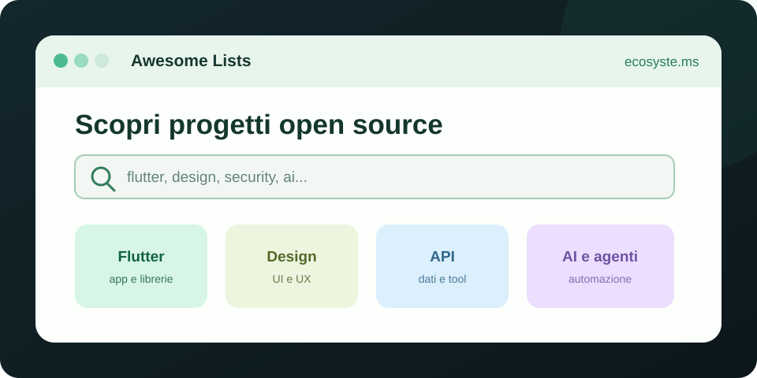

# SITE-001 — Awesome Lists · ecosyste.ms

| Campo | Valore |
|---|---|
| Link | https://awesome.ecosyste.ms/ |
| Categoria principale | **open-source-discovery** |
| Categorie secondarie | development-tools, research-data, learning-resources |
| Tag | awesome-lists, open-source, github, librerie, api, discovery, donor, flutter |
| Verifica | **18/11/2026** |
| Stato | **archiviato-verificato** |
| Tipo | Directory/index e API open source |
| Peso per App Factory | **Alto** come sorgente per scoprire progetti; **non** donor certificato |

## Descrizione breve

Motore di consultazione delle **“awesome lists”**, raccolte curate di software libero e risorse tecniche. Presenta elenchi per argomento, tag e progetti associati; il servizio dichiara un'API aperta. È utile per trovare repository, librerie, strumenti, esempi e fonti di studio senza dover conoscere già il nome del progetto.

## Spunti di impiego

- **App Factory / donor discovery:** cercare pacchetti e repository candidati, annotare fonte originale, licenza e manutenzione; effettuare l'audit di ogni candidato singolarmente.
- **Flutter / Android:** ricercare risorse dedicate, UI/UX, librerie grafiche, test e sviluppo.
- **AI Agent e AppLab:** esplorare raccolte su agenti, automazione, sicurezza, testing e API.
- **Ideas / capability:** individuare categorie di strumenti e funzioni da valutare senza trasferirle automaticamente ai cataloghi delle app.

### Possibili query iniziali

[Flutter](https://awesome.ecosyste.ms/lists?topic=flutter) · [Design](https://awesome.ecosyste.ms/lists?topic=design) · [AI Agents](https://awesome.ecosyste.ms/lists?topic=ai-agents) · [Android](https://awesome.ecosyste.ms/lists?topic=android) · [API](https://awesome.ecosyste.ms/lists?topic=api)

## Note e limiti

Il sito è **un indice di raccolte di terzi**: apparire nella directory non significa essere sicuro, attualmente mantenuto, commercialmente riutilizzabile né compatibile con la App Factory. La licenza del servizio stesso non determina la licenza dei progetti indicizzati. Per estrarre donor o Golden servono esame dei singoli repository, provenienza, verifiche e test.

La copertina è una rappresentazione grafica originale creata per questo catalogo, **non uno screenshot**.

## Fonti

- [Sito originale](https://awesome.ecosyste.ms/)
- [Repository del servizio](https://github.com/ecosyste-ms/awesome)
- [Documentazione API](https://awesome.ecosyste.ms/docs)
