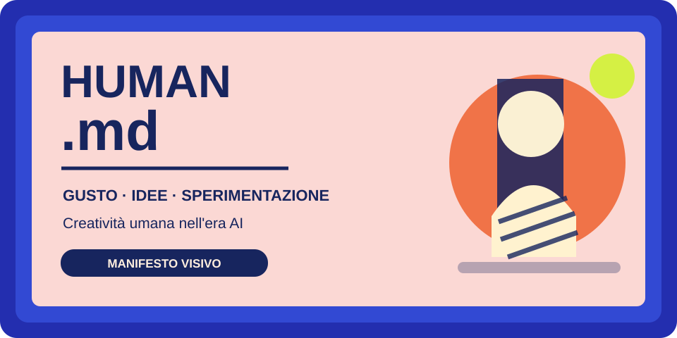

# SITE-002 — HUMAN.md

| Campo | Valore |
|---|---|
| Link | https://www.human-md.ai/ |
| Categoria principale | **motion-storytelling** |
| Categorie secondarie | design-ui-ux, ai-creativity, product-inspiration |
| Tag | manifesto, scrollytelling, motion, graphic-design, storytelling, gsap, personalità, ai |
| Verifica | **18/11/2026** |
| Stato | **archiviato-verificato** (testo); **osservazione visuale da fonte secondaria** |
| Tipo | Manifesto creativo e sito sperimentale |
| Peso per App Factory | **Alto per ispirazione estetica/creativa**, non come donor di codice |

## Descrizione breve

**HUMAN.md**, di **Briana (Mazzio) May**, è un manifesto su ciò che gli esseri umani apportano al lavoro creativo con l'AI: gusto, intuizione, sensibilità, sperimentazione, responsabilità e capacità di costruire. Il sito mette in scena le idee con scenografie audaci, contrasti cromatici, tipografia incisiva e una narrazione con movimenti collegati allo scorrimento.

**Da non confondere con \`human-md.com\`**, un altro servizio con un nome simile.

## Idee da valutare

- **Design-App:** studiare il contrasto tra presentazione editoriale, tipografia, scene tridimensionali/illustrate e ritmo narrativo. Questo link è una **reference candidata**: migrare soltanto elementi estetici realmente pertinenti e verificati.
- **FrameLab / Wonderlog:** presentazioni creative, guide a scorrimento e portfolio emozionali; meglio usarne il linguaggio di comunicazione che imitare l'intera interazione.
- **Anna's Diary / Notes:** ispirazione per copertine, presentazioni di storie o “year in review” opzionali; **non** sostituire la navigazione quotidiana con scene animate.
- **App Factory / UX governance:** porre qualità percepita, originalità e giudizio umano accanto a funzionalità e test, senza sacrificare leggibilità, performance e controllo.

## Cosa NON copiare

La forma immersiva è distintiva, ma lo **scrolljacking** e le animazioni aggressive possono rendere il sito scomodo su smartphone o per chi usa tecnologie assistive. Da replicare, se utile, solo **micro-interazioni controllate**, con opzione \`prefers-reduced-motion\`, scorrimento naturale, alternativa testuale e test su telefono.

**Non copiare immagini, personaggi, codice o testo** del sito senza una licenza/permesso esplicito. La copertina qui sopra è una **illustrazione originale riassuntiva**, non uno screenshot.

## Fonti ed evidenza

- [HUMAN.md — sito e manifesto originale](https://www.human-md.ai/)
- [Analisi visuale e raccolta screenshot — landing.love](https://www.landing.love/sites/human-md/)
- [Discussione pubblica su esperienza mobile e animazioni](https://news.ycombinator.com/item?id=50537962)

**Limite della verifica:** testo verificato da indicizzazione della pagina originale; descrizione delle scene e dell'animazione confrontata con una recensione visuale esterna. Non è stato eseguito un collaudo diretto interattivo su browser/dispositivo.
