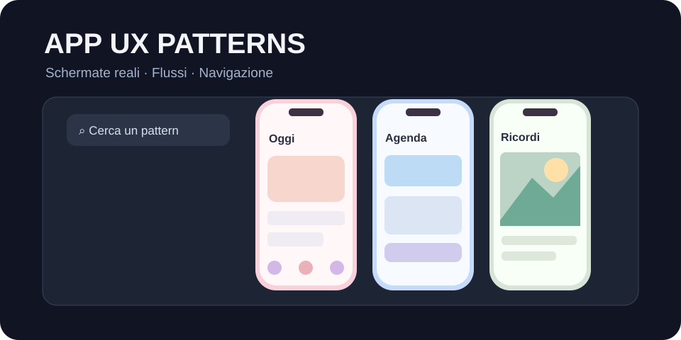

# SITE-003 — Mobbin · iOS Popular

| Campo | Valore |
|---|---|
| URL | https://mobbin.com/discover/apps/ios/popular |
| Categoria principale | **design-ui-ux** |
| Categorie secondarie | product-inspiration, learning-resources |
| Tag | ios, app-screens, user-flows, onboarding, ux-patterns, navigation, research, competitive-benchmark |
| Verifica | **18/11/2026** |
| Stato | **archiviato-parziale**: verificata la piattaforma, non l'intera lista popolare in tempo reale |
| Natura | Libreria di schermate e flussi di prodotti pubblicati, **non libreria di codice** |

## Breve descrizione

**Mobbin** raccoglie screenshot e percorsi UX di app e siti realmente pubblicati. La vista scelta dall'utente è **Discover → Apps → iOS → Popular**; permette di partire da prodotti popolari e approfondire pattern, schermate, funnel e dettagli di interazione. La piattaforma offre anche ricerca di design e raccolte di flussi.

## Potenziali usi in App Factory

- **Anna's Diary:** comparare design di calendari, journaling, fotografia, navigation e onboarding senza adottare automaticamente un intero stile concorrente.
- **Notes-Ecosistema:** studiare editor, navigazione in workspace, ricerca, filtri, onboarding e differenziazione tra desktop e mobile.
- **Omni Cleaner:** studiare architettura delle utility, task progression, conferme e stati vuoti, ricordando che l'app è Android.
- **Wonderlog e World Days:** comparare presentazione editoriale, mappe, timeline e cataloghi.

## Cosa registrare nelle future estrazioni

Quando una schermata specifica colpisce l'utente, registrare in **Design-App** il link preciso, la app/flow/schermata, lo screenshot solo se permesso, la caratteristica da riprendere e l'adattamento necessario. La preferenza per gli elementi già selezionati in Design-App resta prioritaria rispetto alle nuove idee autonome di ChatGPT.

## Licenza e verificabilità

La piattaforma espone design di prodotti terzi: una schermata è un **riferimento di ricerca**, non un asset o un componente libero da copiare. Verificare termini, accessibilità, copyright e coerenza con la Product Bible prima di un'implementazione. L'area Discover completa non è stata ispezionabile pubblicamente senza sessione: non sono qui certificati la classifica, le singole app o eventuali contenuti premium.

La copertina SVG è **originale**, non uno screenshot di Mobbin.

## Fonti

- [Pagina specifica inviata](https://mobbin.com/discover/apps/ios/popular)
- [Piattaforma Mobbin](https://mobbin.com/)
- [Panoramica dei flussi e delle funzionalità](https://mobbin.com/blog/mobbin-vs-page-flows)
