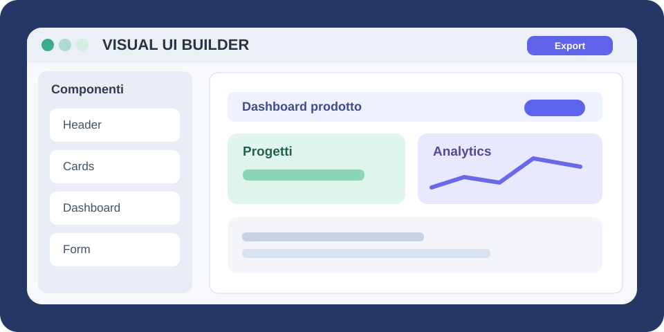

# SITE-004 — Shuffle

| Campo | Valore |
|---|---|
| URL | https://shuffle.dev/ |
| Categoria principale | **development-tools** |
| Categorie secondarie | design-ui-ux, ui-component-libraries, product-inspiration |
| Tag | visual-editor, website-builder, tailwind, bootstrap, bulma, react, shadcn-ui, responsive, dashboard, landing |
| Verifica | **18/11/2026** |
| Stato | **archiviato-verificato** |
| Natura | Editor visuale, librerie UI e generazione/esportazione di codice Web |

## Breve descrizione

**Shuffle** offre un editor visivo drag-and-drop e raccolte di componenti responsive. La documentazione ufficiale descrive l'utilizzo con Tailwind CSS, Bootstrap, Bulma, Material UI e shadcn/ui, insieme a esportazioni di progetti e integrazioni per workflow web. Comprende strumenti AI per proporre o modificare sezioni.

## Potenziali usi in App Factory

- **App Factory dashboard / Site:** componenti per schede progetto, filtri, statistiche, roadmap, pannelli e layout adattivi.
- **Web Utility / SEO-first:** landing page, pagine informative, calculator UI e dashboard web-native con framework adatti all'indicizzazione.
- **Notes-Ecosistema Web:** ispirazione per pagine e pannelli funzionali, previa verifica di responsive e interazioni.
- **App Flutter:** riutilizzare **il concept di layout**, non assumere che il codice Web esportato funzioni direttamente in Flutter.

## Cosa valutare

Pattern di navigazione, griglie responsive, gestione degli stati, componenti modulari, editor drag-and-drop e coerenza fra pagine. Verificare l'esatta licenza, condizioni del piano e diritti di esportazione prima di integrare codice di librerie commerciali; non presentare tutte le risorse come open source.

**Nota estetica:** eventuali riferimenti a Material UI sul sito Shuffle descrivono una tecnologia supportata da Shuffle, **non** una raccomandazione a riadottare Material 3 come identità grafica della App Factory.

La copertina SVG è **originale**, non uno screenshot.

## Fonti

- [Shuffle](https://shuffle.dev/)
- [Documentazione dell'editor](https://shuffle.dev/docs/editor)
- [Catalogo componenti](https://shuffle.dev/components)
