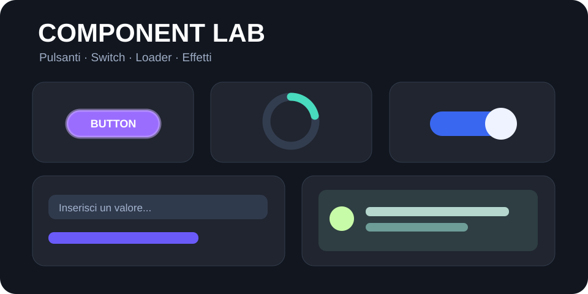

# SITE-005 — Uiverse

| Campo | Valore |
|---|---|
| URL | https://uiverse.io/ |
| Categoria principale | **ui-component-libraries** |
| Categorie secondarie | design-ui-ux, development-tools, motion-storytelling |
| Tag | css, buttons, loaders, inputs, cards, toggles, hover, transitions, tailwind, react, figma |
| Verifica | **18/11/2026** |
| Stato | **archiviato-verificato** |
| Natura | Raccolta community-made di componenti UI, snippet e micro-interazioni |

## Breve descrizione

**Uiverse** raccoglie elementi di interfaccia condivisi dalla community: pulsanti animati, loader, input, switch, card, interazioni hover e altri componenti. Il portale consente di esplorarli e riportarli in **HTML/CSS, Tailwind, React e Figma**. Il sito dichiara una **licenza MIT** per i suoi elementi UI e l'utilizzabilità anche commerciale.

## Potenziali usi in App Factory

- **Design-App:** individuare e selezionare **specifici componenti** visivi per aggiungere qualità a pulsanti, transizioni, progress indicator e stati vuoti. Ogni componente scelto va identificato con URL/autore e compatibilità.
- **Anna's Diary:** micro-animazioni leggere per acquisizione contenuto, salvataggio e feedback, soltanto se coerenti con l'identità editoriale.
- **Android Omni Cleaner / Battery Guard / FocusSense:** indicatori di progresso e micro-feedback semantici, senza sprecare frame o batteria.
- **Dashboard e Web Utility:** codice Web da valutare per integrazione diretta, verificando qualità, accessibilità e adattività.

## Regole di riuso

La dichiarazione MIT generale non equivale a un controllo automatico di ogni snippet e asset accessorio. Prima di copiare: verificare origine, condizioni del componente, attribuzioni/copyright, contrasto, keyboard focus, semantic labels e rispetto di reduced motion. **Il codice CSS o React non è codice Flutter:** per app Flutter adottare il pattern tramite adattamento tecnico.

**Non rendere predefinita la motion decorativa.** I pattern già curati dall'utente in Design-App restano prioritari.

La copertina SVG è **originale**, non uno screenshot.

## Fonti

- [Uiverse homepage e licenza dichiarata](https://uiverse.io/)
- [Raccolta collegata Uiverse Galaxy](https://github.com/uiverse-io/galaxy)
