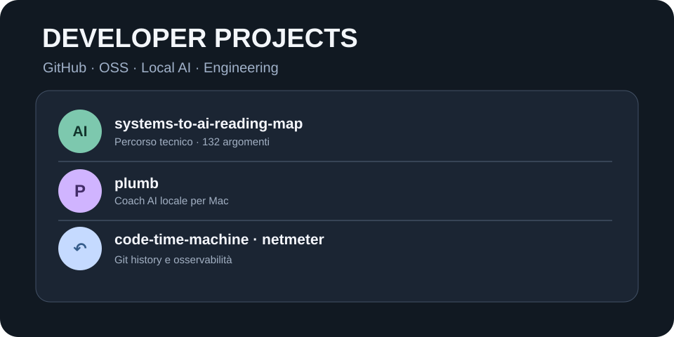

# SITE-006 — Profilo GitHub nagavineerpasam

| Campo | Valore |
|---|---|
| Link inviato | https://github.com/nagavineerpasam?tab=repositories |
| Categoria principale | **github-profiles** |
| Categorie secondarie | open-source-discovery, development-tools, learning-resources, product-inspiration |
| Tag | github-profile, learning, local-ai, vscode, network-tools, developer-tools, oss, reference |
| Verifica | **18/11/2026** |
| Stato | **archiviato-verificato** (profilo e 12 repository pubblicamente enumerati) |
| Natura | Profilo di sviluppatore / **collezione dinamica di repository**, non un singolo donor |

## Breve descrizione

Profilo GitHub contenente progetti personali, strumenti per sviluppatori, applicazioni e una guida di studio. Il numero e lo stato dei repository possono cambiare; le informazioni riportate costituiscono uno **snapshot del 18 novembre 2026**. Non è corretto associare una sola licenza o valutazione di qualità all'intero profilo.

## Quattro repository da tenere d'occhio

| Repository | Contenuto verificato | Licenza dichiarata nel metadata | Interesse per App Factory |
|---|---|---|---|
| [systems-to-ai-reading-map](https://github.com/nagavineerpasam/systems-to-ai-reading-map) | Mappa di studio **132 argomenti / 14 libri**, dai sistemi informatici a ML e LLM | MIT | Formazione ingegneristica App Factory / AI Agent |
| [plumb](https://github.com/nagavineerpasam/plumb) | Coach di inglese su Mac con modello AI locale, analisi di testo e voce, progressi e privacy | Apache-2.0 | Riferimento concettuale Notes per AI locale e feedback, non donor Flutter diretto |
| [code-time-machine](https://github.com/nagavineerpasam/code-time-machine) | Estensione VS Code per tracciare l'evoluzione di funzioni e blocchi attraverso i commit Git | Licenza non rilevata nei metadata GitHub | Strumento da studiare per audit, provenance e comprensione delle modifiche |
| [netmeter](https://github.com/nagavineerpasam/netmeter) | Monitor del traffico di rete della sessione Claude Code, integrato nella status line su macOS | MIT | Osservabilità degli agenti, solo dopo verifica applicabilità all'ambiente |

Altri repository rilevati: **react-native-realestate-app**, **moviesearchApp**, **shopNOW**, **expense-tracker**, **Live-Advice-App**, **nagavineerpasam.github.io**, **public-apis** (fork) e **plumb-releases**. Elenco derivato dai repository pubblici enumerabili alla verifica, non certificazione individuale del sorgente.

## Opportunità e limiti

- **Learning:** usare il reading map come indice per approfondire aspetti complessi di architettura e sistemi.
- **AI offline / Notes:** osservare la filosofia di Plumb, senza assumere portabilità diretta da Swift/macOS a Flutter/Android; il README riporta modelli scaricati separatamente e requisiti hardware significativi.
- **App Factory / QA:** analizzare Code Time Machine come idea per la tracciabilità delle modifiche, senza copiarne il codice in assenza di licenza chiara.
- **Agenti:** studiare netmeter per telemetria limitata alla sessione, ma non attribuire funzioni native a ChatGPT o App Factory Agent senza prove.

Ogni repository deve superare **verifica di licenza, SHA sorgente, qualità, test, architettura, privacy e compatibilità** prima di essere promosso a donor/capability. Questa scheda non importa codice e non inserisce stelle GitHub.

La copertina SVG è **originale**, non lo screenshot del profilo.

## Fonti

- [Profilo GitHub originale](https://github.com/nagavineerpasam?tab=repositories)
- [README Systems to AI](https://github.com/nagavineerpasam/systems-to-ai-reading-map)
- [README Plumb](https://github.com/nagavineerpasam/plumb)
- [README Code Time Machine](https://github.com/nagavineerpasam/code-time-machine)
- [README netmeter](https://github.com/nagavineerpasam/netmeter)
