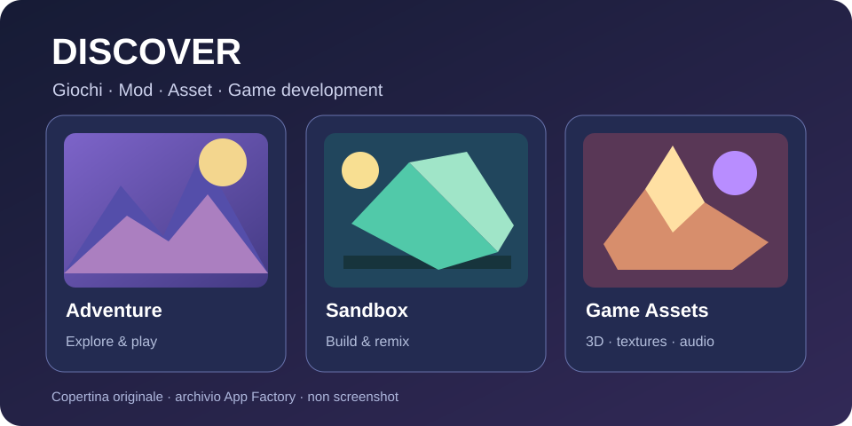

# SITE-007 — Patch · Discover

| Campo | Valore |
|---|---|
| URL | https://patch.gg/discover |
| Categoria principale | **game-development** |
| Categorie secondarie | game-asset-libraries, product-inspiration, development-tools, ai-creativity |
| Tag | games, mods, remix, assets, 3d, textures, sounds, cli, mcp, coding-agents |
| Verifica | **18/11/2026** |
| Stato | **archiviato-verificato** (funzionalità dichiarate e pagina Discover; nessun test runtime) |
| Natura | Catalogo giochi/mod e piattaforma di costruzione, remix e distribuzione di esperienze interattive |

## Breve descrizione

**Patch** è una piattaforma che consente di trovare, giocare, creare, pubblicare e remixare videogiochi e mod. La pagina **Discover** presenta giochi e mod, con generi come azione, avventura, guida, RPG, sandbox, simulazione e strategia. Il catalogo è dinamico: classifiche e titoli mostrati oggi possono variare.

Dal sito ufficiale risultano disponibili:

- **Patch Desktop per Windows** e fruizione di giochi browser.
- Una libreria dichiarata di oltre **50.000 asset** (modelli 3D, texture, materiali, personaggi e suoni) con informazioni di licenza/attribuzione.
- Uno stack di strumenti per lo sviluppo di videogiochi integrabile mediante **CLI e server MCP** con agenti di coding.
- Meccanismi per **remixare** giochi e parti dei progetti resi disponibili su Patch.

Queste sono **funzionalità dichiarate dal fornitore**, non risultati di test svolti in App Factory.

## Utilità potenziale per App Factory

| Ambito | Opportunità da valutare | Vincolo |
|---|---|---|
| **Deskland** | Studiare mondi esplorabili, rendering, interazioni e materiali game-ready come riferimento concettuale | Non assumere che asset o giochi siano liberamente esportabili su Android |
| **App Factory Agent** | Analizzare come Patch espone tool game-dev a un agente tramite CLI/MCP | Non collegare servizi o concedere chiavi/token automaticamente |
| **Prototipi/giochi** | Osservare sistemi di remix, esperienza web playable, meccaniche e community | Verificare stack, permessi, costi e licenze |
| **Design-App** | Selezionare riferimenti di game UI/UX e motion quando approvati per un'app specifica | La semplice scheda non autorizza a trasferire asset, texture o screenshot |

## Vincolo di licenza fondamentale

**Non confondere “remixabile su Patch” con “open source riusabile liberamente fuori Patch”.**

Nei [Termini ufficiali del 16 novembre 2026](https://patch.gg/terms) si legge che ogni repository espone una propria licenza. La **Patch License** predefinita consente in generale a utenti Patch di vedere e remixare il lavoro all'interno della piattaforma, ma **non autorizza a portare fuori Patch il lavoro altrui senza consenso dell'autore**. Per gli asset della libreria che la piattaforma dichiara open source, verificare **licenza e attribuzione del singolo asset**, non basarsi su un'etichetta globale.

Per ogni riutilizzo in app commerciali o distribuite: provenance, licenza specifica, diritti su asset audio/visuali, compatibilità software e test. La riproduzione di mod può inoltre essere soggetta ai termini dei titolari dei giochi originali.

## Sicurezza, privacy e integrazione

- Patch Desktop e mod eseguono componenti locali: fare una revisione di sicurezza prima dell'installazione.
- CLI/MCP e agenti possono ottenere capacità operative: limitare credenziali e privilegi, controllare azioni esterne e costi.
- I Termini specificano che lo sviluppo/build di un progetto viene fatto sul PC o nella CI dell'utente: **Patch non costruisce automaticamente il gioco per conto dell'utente**.
- La [Privacy Policy](https://patch.gg/privacy) descrive i dati raccolti per analytics e l'uso dei contenuti: leggerla prima di creare un account o collegare agenti.

La copertina in questa scheda è un'**illustrazione originale**, non uno screenshot né un asset di Patch.

## Fonti verificate

- [Patch Discover — collegamento inviato](https://patch.gg/discover)
- [Patch — homepage e funzionalità dichiarate](https://patch.gg/)
- [Terms of Service — aggiornati al 16/11/2026](https://patch.gg/terms)
- [Privacy Policy — aggiornata al 16/11/2026](https://patch.gg/privacy)
