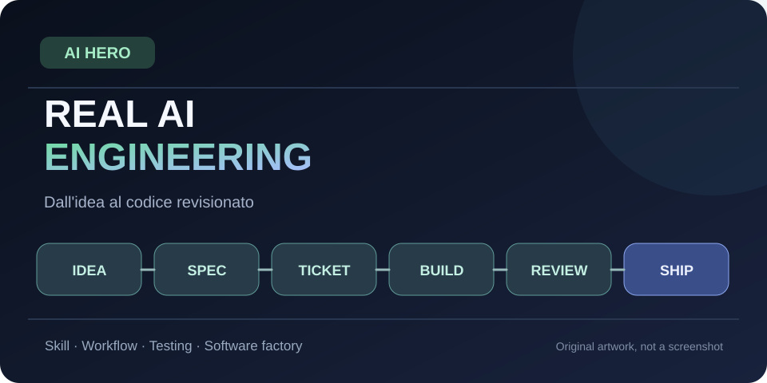

# SITE-008 — AI Hero · Real AI Engineering

| Campo | Valore |
|---|---|
| URL | https://www.aihero.dev/ |
| Autore | **Matt Pocock** |
| Categoria principale | **ai-engineering-workflows** |
| Categorie secondarie | development-tools, learning-resources, open-source-discovery, product-inspiration |
| Tag | coding-agents, software-factory, agent-skills, specs, tickets, TDD, code review, architecture, MCP |
| Data verifica | **18 novembre 2026** |
| Stato | **archiviato-verificato** per funzioni dichiarate e documenti pubblici; nessun test delle skill |
| Valore per App Factory | **Alto come riferimento tecnico e procedurale**, ma non ancora capability o Golden |

## Breve descrizione

**AI Hero** raccoglie metodi e contenuti formativi di **Matt Pocock** per collaborare con coding agent mantenendo disciplina ingegneristica. Il sito propone skill componibili, articoli, video e corsi, con una sequenza operativa dall'idea fino all'implementazione e alla revisione del codice. La homepage elenca skill gratuite e un corso email gratuito; altri contenuti formativi possono essere commerciali.

## Risorse e processi esaminati

| Area | Skill / contenuto | Spunto per App Factory |
|---|---|---|
| Processo idea → ship | **/grill-with-docs, /to-spec, /to-tickets, /implement, /code-review, /retro** | Documentazione decisioni → requisiti → task → PR → verifica |
| Shaping | **/wayfinder, /prototype, /research** | Analisi delle incognite, ricerca con fonti, prototipi eliminabili |
| Qualità del codice | **/diagnosing-bugs, /tdd, /improve-codebase-architecture, /codebase-design** | Repro prima della correzione, cicli red-green-refactor, audit architetturali |
| Contesto e manutenzione | **/handoff, /writing-for-agents, /domain-modeling, /triage** | Sessioni riprendibili, documenti leggibili dagli agenti, linguaggio condiviso |
| Apprendimento | **LLM Fundamentals, AI Engineer Roadmap, AI Coding Dictionary, AI SDK, MCP Tutorial** | Comprendere meglio modelli, strumenti, agenti e metodi di sviluppo |

**Differenza rilevata:** la homepage indicava **27 skill**, la pagina dedicata **25**. Si tratta probabilmente di pagine con aggiornamenti non sincronizzati; non riportare un conteggio canonico senza nuova verifica.

## Come potrebbe aiutare il progetto

- **App Factory Core:** audit comparativo delle skill con le regole in CURRENT e col Master vigente, per scoprire piccoli miglioramenti non già previsti.
- **App Factory Agent:** esplorare handoff, task decomposition, correzione dei bug e controllo delle istruzioni senza introdurre comportamenti autonomi non autorizzati.
- **AppLab:** valutare la disciplina di review e feedback loop, distinguendo qualità del metodo da test effettivamente passati.
- **Golden e capability:** selezionare soltanto procedure con vantaggio tecnico dimostrabile, provenance e condizioni di riuso verificate.
- **Tutte le app:** modello di analisi prima delle modifiche complesse, utile soprattutto per sviluppo incrementale, grandi roadmap e riduzione di regressioni.

### Priorità di studio proposte (nostra valutazione, non priorità dell'autore)

**P1:** /to-spec + /to-tickets, /code-review + /tdd + /diagnosing-bugs, /handoff + /writing-for-agents.

**P2:** /domain-modeling, /improve-codebase-architecture, /research, /prototype.

L'interesse è principalmente **procedurale**, non estetico. Non è una fonte che supera le reference visive approvate in Design-App.

## Repository di riferimento e licenza

**[mattpocock/skills](https://github.com/mattpocock/skills)** è il repository pubblico collegato al sito. La licenza **MIT** è stata verificata leggendo [LICENSE](https://github.com/mattpocock/skills/blob/main/LICENSE). SHA sorgente registrato: **5863806dd4e15c63174bee4e7515a4256792ecfa** (GitHub main, verifica 18/11/2026).

La licenza del repository **non** autorizza automaticamente a riprodurre i corsi a pagamento, gli articoli, i video o le grafiche del sito. Per ogni skill candidata servono file specifico, licenza, versione/commit, analisi delle dipendenze, eventuale adattamento e test.

## Vincoli operativi e limiti

- Il Master e i Golden di **App-Factory-Core** mantengono la precedenza sulle skill esterne.
- Nessuna installazione/importazione automatica è stata effettuata.
- Non introdurre comandi che bypassino permessi, review, branch protection o verifiche di release.
- Le integrazioni con strumenti come Claude Code/Codex descritte dall'autore non sono automaticamente equivalenti al nostro ambiente **solo Chat**.
- Evitare di importare una skill già coperta da policy consolidate: confrontare i contratti e misurare un piccolo pilot prima della promozione.

## Fonti dirette

- [Sito ufficiale](https://www.aihero.dev/)
- [Catalogo skill](https://www.aihero.dev/skills)
- [Articoli](https://www.aihero.dev/posts)
- [Corsi](https://www.aihero.dev/courses)
- [Repository skills](https://github.com/mattpocock/skills)
- [Licenza MIT](https://github.com/mattpocock/skills/blob/main/LICENSE)

Copertina SVG creata per il catalogo: **illustrazione originale**, non screenshot del portale.
