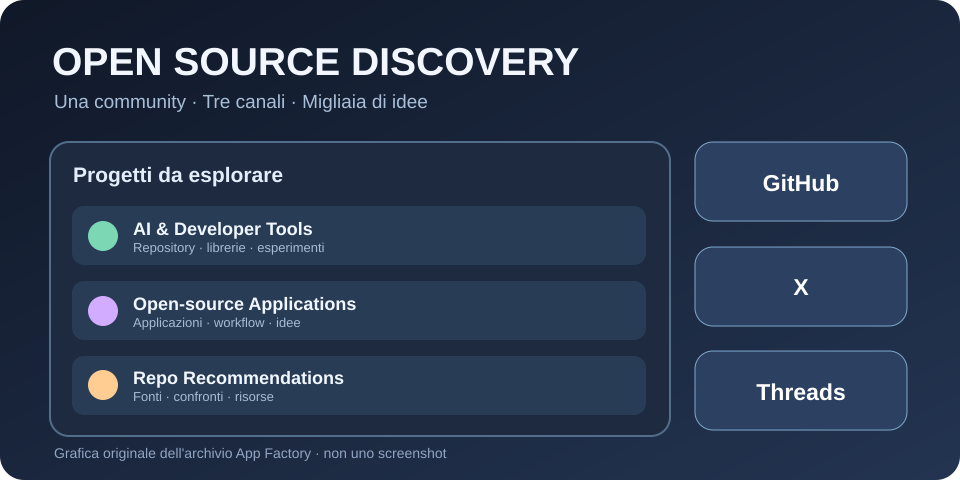

# SITE-009 — GitHub Projects Community

| Campo | Valore |
|---|---|
| Categoria principale | **open-source-curators** |
| Categorie secondarie | open-source-discovery, github-profiles, development-tools, learning-resources, product-inspiration |
| Tag | github, X, Threads, open-source, community, repo-discovery, tools, ideas |
| Verifica | **18 novembre 2026** |
| Stato | **archiviato-parziale**: GitHub e descrizione X verificati, Threads non leggibile direttamente |
| Tipologia | Community di discovery OSS, **non** servizio ufficiale GitHub né funzione di project management |

## Tre collegamenti forniti

| Canale | Link | Stato della verifica |
|---|---|---|
| **GitHub** | https://github.com/githubpr0jects | Organizzazione GitHub e quattro repository pubblici verificati |
| **X** | https://x.com/GithubProjects | Profilo “GitHub Projects Community” identificato; si dichiara esplicitamente **UNOFFICIAL** |
| **Threads** | https://www.threads.com/@githubprojects | URL conservato; la piattaforma non ha permesso l'accesso diretto nel browser. Post associati a questo handle risultano citati da fonti esterne |

**Fonte aggiuntiva da consultare:** [Open-source Projects](https://www.opensourceprojects.dev/) è un sito di selezione e presentazione di progetti OSS, con schede e bookmark. È collegato ai post della community osservati su X; l'associazione editoriale è **fortemente suggerita** dai collegamenti pubblici, ma qui non viene trattata come prova giuridica di proprietà comune.

## Perché è interessante

La community è una **fonte ricorrente di scoperta** di progetti open source e strumenti per sviluppatori. È più utile per intercettare candidati e nuove idee rispetto a considerarla un donor di codice singolo.

- Progetti open source emergenti, con utilità concreta per strumenti e applicazioni.
- Tool per AI, agenti, produttività, developer experience e infrastruttura.
- Approfondimenti e presentazioni sintetiche che facilitano uno screening preliminare.
- Repository della propria organizzazione, separati dai progetti che promuove sui social.

La dicitura “GitHub Projects” nel nome **non significa** appartenenza a GitHub Inc. e **non indica** la funzionalità ufficiale GitHub Projects per gestire issue e roadmap.

## Repository direttamente presenti nell'organizzazione GitHub

| Repository | Cosa risulta al 18/11/2026 | Note di affidabilità |
|---|---|---|
| [open-source-projects](https://github.com/githubpr0jects/open-source-projects) | Progetto JavaScript/Next.js, legato all'esplorazione open source | README generico derivato da create-next-app; verificare codice e funzionamento separatamente |
| [repo-recommender](https://github.com/githubpr0jects/repo-recommender) | Prototipo di raccomandazione di repository GitHub | Nessun test eseguito |
| [repo-recomender](https://github.com/githubpr0jects/repo-recomender) | Ricerca/raccomandazione GitHub dichiarata come creata con MiniMax M2.1 | Non confondere con il repo dal nome simile; verifica tecnica non svolta |
| [deals-for-devs](https://github.com/githubpr0jects/deals-for-devs) | Lista community di offerte, codici e sconti per sviluppatori | README contiene offerte del 2024 e link segnaposto; **non considerare i coupon validi oggi** |

La presenza nell'organizzazione e il nome dei progetti **non dimostrano qualità, sicurezza, utilità o licenza compatibile**.

**Licenze:** durante la verifica non è stato trovato un file `LICENSE` alla radice di questi quattro repository. Controllare licenze specifiche e condizioni dei singoli file prima di utilizzare qualsiasi codice o asset.

## Possibili applicazioni nella App Factory

1. **Scouting donor / Golden / capability:** scegliere da post e schede un repository **originale**, controllare licenza, provenienza, commit immutabile, manutenzione, compatibilità e test. Soltanto allora proporre eventuali donor.
2. **Idee-app-Archivi-riferimenti:** intercettare pattern, nuovi tool e problematiche utili per altre app, classificando idee e decisioni senza confonderle con implementazioni.
3. **App Factory Agent:** valutare separatamente strumenti agentici o di automazione suggeriti, senza eseguire/installare automaticamente comandi trovati nei post social.
4. **Design-App:** i progetti UI/UX segnalati dalla community possono diventare *candidate reference*, ma non prevalgono sui design già curati dall'utente in Design-App.
5. **Sito operativo App Factory:** potrebbe essere utile una sezione “feed fonti”, con link di origine e stato “da valutare”. **Non** implica avere già integrazioni o feed in tempo reale.

## Procedura consigliata quando trovi un post interessante

Salvare l'**URL del post specifico** e soprattutto quello del **repository originale**. Estrarre in una scheda dedicata nome e problema risolto, licenza, linguaggio, commit, stato di attività, possibili app destinatarie, rischio tecnico e stato di prova. Non assegnare stelle né copiare codice in automatico sulla base dell'annuncio.

## Provenienza, limiti e immagini

- GitHub e repository verificati direttamente via API/README pubblici.
- La bio di X dichiara “UNOFFICIAL”; non confondere il canale con GitHub ufficiale.
- Threads non accessibile direttamente dalla sessione; esistono riferimenti indipendenti a post del medesimo handle, ma non è stata effettuata la lettura dell'intero profilo.
- Il portale editoriale Open-source Projects è stato consultato come ulteriore fonte: non viene aggiunto come entità separata senza un motivo specifico.
- La copertina allegata è un'**illustrazione originale**, non uno screenshot o un asset di GitHub/X/Threads.

## Fonti

- [Organizzazione GitHub](https://github.com/githubpr0jects)
- [Community su X](https://x.com/GithubProjects/with_replies)
- [Account Threads indicato dall'utente](https://www.threads.com/@githubprojects)
- [Portale Open-source Projects](https://www.opensourceprojects.dev/)
- [Chi siamo — Open-source Projects](https://www.opensourceprojects.dev/about)
- [Riferimento indipendente alle menzioni X e Threads](https://www.celaster.me/)
