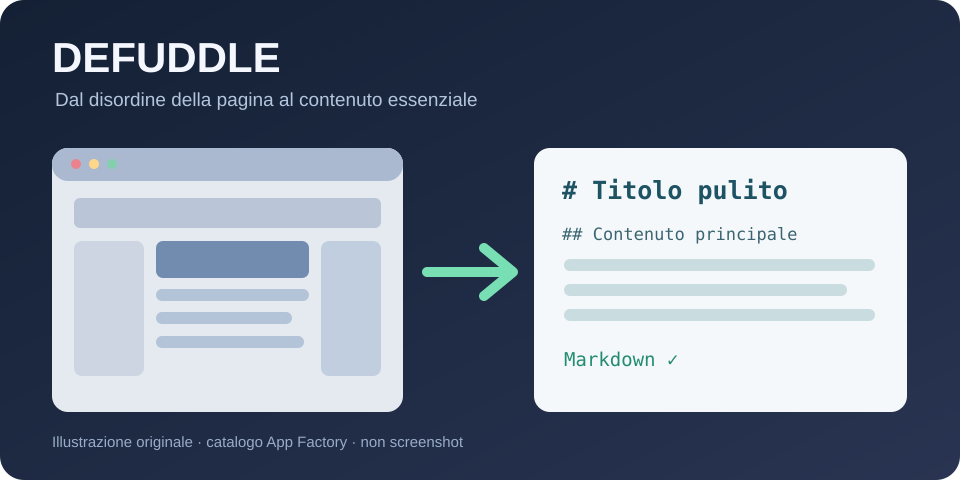

# SITE-010 — Defuddle · Estrazione dei contenuti web

| Campo | Valore |
|---|---|
| Repository canonico | **https://github.com/kepano/defuddle** |
| Sito ufficiale | https://defuddle.md/ |
| URL abbreviato originariamente ricevuto | **https://t.co/tJBq3MOiLo** |
| Identificazione del link abbreviato | **Confermata dall'utente il 18/11/2026**; redirect non osservato direttamente dagli strumenti |
| Categoria principale | **development-tools** |
| Categorie secondarie | open-source-discovery, research-data, learning-resources |
| Stack | TypeScript / JavaScript, browser, Node.js e CLI |
| Licenza verificata | **MIT**, file LICENSE nel repository; copyright Steph Ango |
| Stato catalogo | **archiviato-verificato** (progetto e contenuti); associazione t.co **confermata dall'utente** |
| Data | **18 novembre 2026** |

## Descrizione

**Defuddle**, di **Steph Ango (@kepano)**, estrae il contenuto principale di una pagina Web, eliminando elementi secondari come commenti, sidebar, intestazioni, piè di pagina e parti non rilevanti. Può elaborare un URL o un documento HTML e restituire contenuti HTML ripuliti, Markdown e metadati della pagina.

È nato per [Obsidian Web Clipper](https://github.com/obsidianmd/obsidian-clipper) e viene proposto come alternativa a Mozilla Readability, con particolare attenzione a mantenere note, formule, blocchi di codice e metadati.

## Funzionalità riportate nel README ufficiale

- **Browser:** importazione della libreria JavaScript e parsing di un DOM.
- **Node.js:** parsing di un documento DOM tramite librerie come LinkeDOM, JSDOM o happy-dom.
- **CLI:** accetta URL, file HTML oppure HTML dallo standard input; permette output Markdown, JSON e frontmatter.
- **Metadati:** titolo, autore, descrizione, dominio, lingua, data, favicon, schema.org e altri attributi.
- **Varianti di bundle:** core, full e Node.js per esigenze diverse.

Sono caratteristiche dichiarate nel README, **non test funzionali eseguiti in questa sessione**. Il progetto segnala esplicitamente di essere ancora *work in progress*.

## Possibili utilizzi nella App Factory

| Ambito | Applicazione da valutare | Cosa verificare |
|---|---|---|
| **App Factory Agent** | Preparare testo e metadati da URL disponibili per agenti di analisi | Sorgente esatta, input non fidato, sanitizzazione e controllo accesso rete |
| **Catalogo siti / scouting** | Leggere contenuti e metadati da documentazioni, pagine tecniche e articoli | Accuratezza estrazione, deduplicazione, rispetto dei termini delle fonti |
| **Notes-Ecosistema** | Importare pagine web in Markdown e note consultabili | Compatibilità Flutter/Android; probabile necessità di adattatore JS/server |
| **World Days** | Valutare una pipeline di preparazione di fonti per storie documentate | Conservare citazioni e URL originali; non confondere parsing e certificazione fattuale |

**Non usare Defuddle per aggirare paywall, credenziali, controlli d'accesso o licenze.** Il contenuto estratto rimane soggetto ai diritti degli autori e richiede verifiche prima di essere pubblicato o integrato.

## Verifica della fonte, provenienza e limiti

1. Il collegamento **t.co/tJBq3MOiLo** era inizialmente irrisolto tramite gli strumenti di navigazione.
2. L'utente ha identificato **Defuddle** come destinazione e successivamente **confermato esplicitamente** l'associazione il 18 novembre 2026.
3. Il repository GitHub **kepano/defuddle**, il README, il sito indicato come homepage e la licenza MIT sono stati verificati tramite GitHub.
4. **Non affermiamo** di aver seguito e certificato autonomamente il redirect t.co: questa specifica associazione deriva dalla conferma dell'utente.
5. Snapshot GitHub di main verificato: `3e8bde9f5f855bc968e95837a750c5968a9fe639`. Nessun test di installazione, benchmark o audit sicurezza eseguito.

### Requisiti prima del possibile riuso del codice

- Controllare versione e commit, sicurezza dipendenze, bundle size e compatibilità con l'ambiente target.
- Validare la qualità su pagine reali, inclusi contenuti tecnici, metadati, tabelle e layout complessi.
- Gestire input HTML/Web non fidati e possibili istruzioni malevole presenti nel testo estratto.
- Conservare URL e data di acquisizione; non attribuire all'estrattore la validazione editoriale di ciò che trova.
- Conservare licenza e copyright MIT quando applicabile e rispettare i diritti dei testi/siti acquisiti.

## Fonti

- [Repository Defuddle](https://github.com/kepano/defuddle)
- [Sito ufficiale](https://defuddle.md/)
- [README](https://github.com/kepano/defuddle/blob/main/README.md)
- [Licenza MIT](https://github.com/kepano/defuddle/blob/main/LICENSE)
- [URL abbreviato originale](https://t.co/tJBq3MOiLo)

*Immagine: copertina SVG originale del catalogo, non screenshot né asset di Defuddle.*
